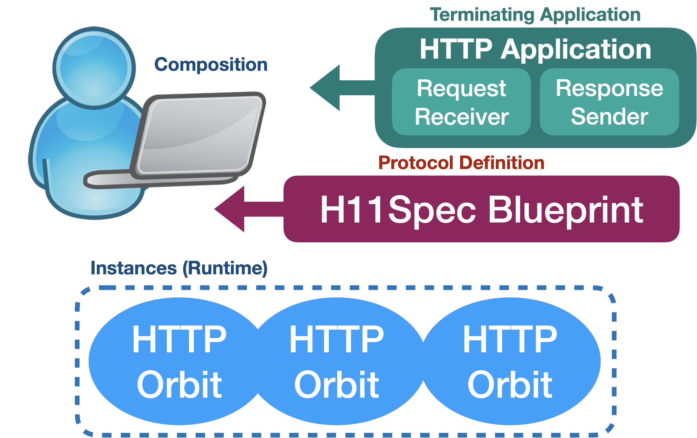

# h11spec

This sans-io package is used by YAWS for HTTP/1.1 Implementation.

## Crates

| Crate       | Description                     |
| :---        | :---                            |
| [h11types](./h11types) | Core H11spec Types       |
| [blueprint-h11spec](./blueprint) | H11Spec BluePrint & Orbit Implementation |

### License

This project is licensed under either of

 * Apache License, Version 2.0, ([LICENSE-APACHE](LICENSE-APACHE) or
   http://www.apache.org/licenses/LICENSE-2.0)
 * MIT license ([LICENSE-MIT](LICENSE-MIT) or
   http://opensource.org/licenses/MIT)

at your option.

### Contribution

Unless you explicitly state otherwise, any contribution intentionally submitted
for inclusion by you, as defined in the Apache-2.0 license, shall be dual licensed as above, without any additional terms or conditions.