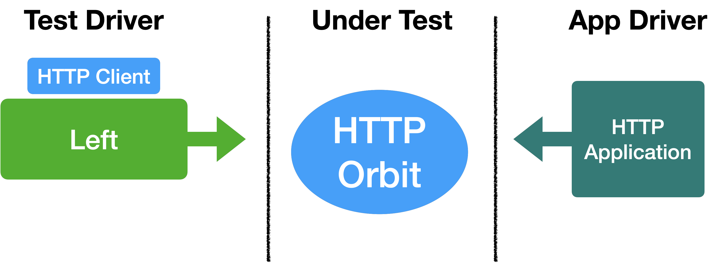
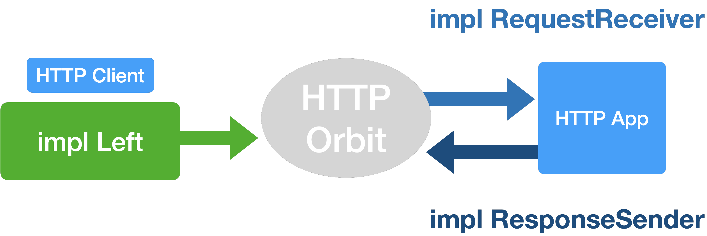

# Test YAWS H11Spec

Serves to integration test H11Spec Blueprint & Orbit as isolated state machine.

# Under Test

The tests are data driven and injected through Left and the "terminating" H11Spec Request & Response implementations.

# Left and Right Driver

Left side is the HTTP Client network side and the Right side not used given the H11Spec is implemented as a terminating network protocol layer.

Responder HTTP Server application layer is injected through as H11Spec configuration to respond to the HTTP Client requests.

